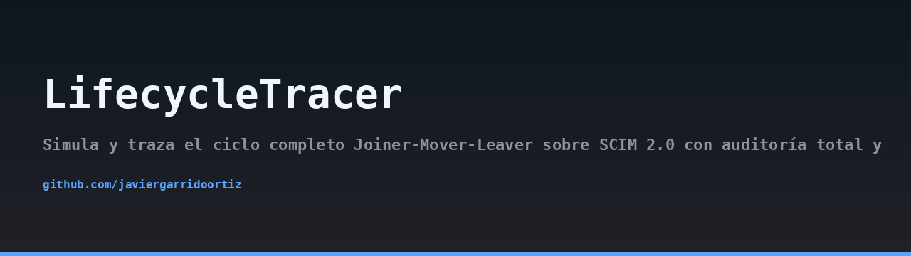
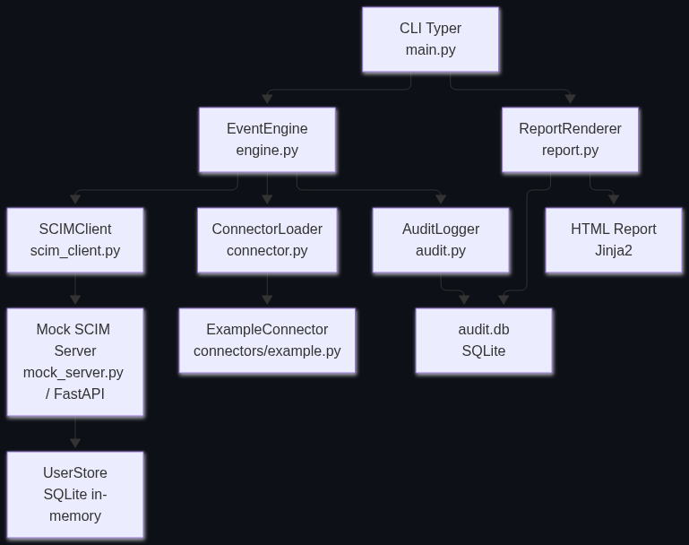
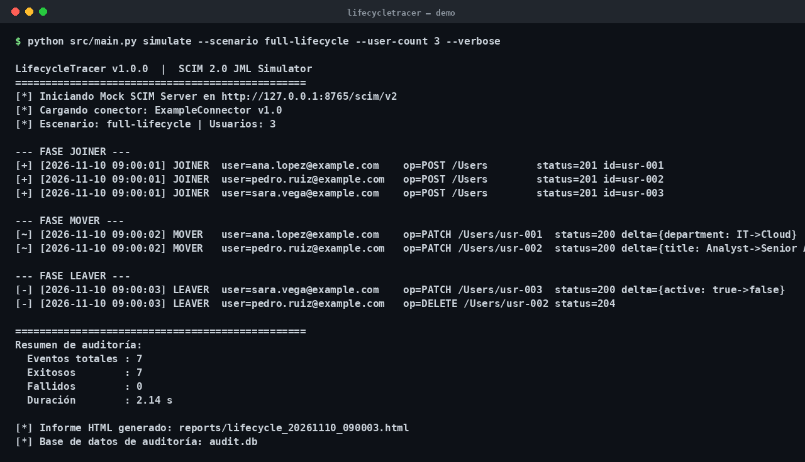

## Architecture



## Demo



> 🇪🇸 Read this in [Spanish](README.md).

# LifecycleTracer

LifecycleTracer simulates and traces the complete Joiner-Mover-Leaver (JML) lifecycle over SCIM 2.0, with full auditing and an example connector. It is a practical tool for validating identity provisioning flows against any SCIM-compliant endpoint, and for teaching how the JML cycle behaves end to end.

The project ships with a mock SCIM server so you can run a full simulation locally without external dependencies, and an example connector that demonstrates how to transform lifecycle events into concrete SCIM payloads. Swapping the mock for a real endpoint (IdentityNow, Okta, Azure AD, etc.) only requires changing the base URL in the configuration.

## Features

- Full Joiner-Mover-Leaver simulation driven by YAML scenarios.
- SCIM 2.0 client built on `httpx` with support for `GET`, `POST`, `PATCH` and `DELETE` on `/scim/v2/Users`.
- Mock SCIM server (FastAPI) running in a background thread, so the CLI and the server coexist in the same process.
- Persistent audit log in SQLite: every event is recorded with timestamp, action, actor, target and outcome.
- HTML report generation with Jinja2, including a timeline of events and a per-user summary.
- Pluggable connector protocol: implement it and drop your connector into `src/connectors/`.
- Typer-based CLI with `simulate`, `report` and `validate` commands.
- Test suite with `pytest` and `pytest-asyncio` covering engine, client and mock server.

## Architecture

LifecycleTracer is organized into clearly separated layers:

- **Entry layer**: a Typer CLI (`src/main.py`) exposing the `simulate`, `report` and `validate` commands.
- **Orchestration**: the `EventEngine` (`src/engine.py`) reads a YAML scenario from `scenarios/`, drives the JML sequence, delegates SCIM calls to the client and records each event in the audit logger.
- **SCIM client**: `src/scim_client.py`, based on `httpx`, handles HTTP communication with the SCIM endpoint.
- **Audit**: `src/audit.py` persists every event to SQLite using the standard `sqlite3` module.
- **Mock server**: `src/mock_server.py` is a FastAPI application implementing SCIM 2.0 endpoints and backed by an in-memory `UserStore`. It is started in a background thread during simulations.
- **Connectors**: `src/connector.py` defines the connector protocol; `src/connectors/example.py` is the reference implementation that maps lifecycle events to SCIM payloads.
- **Reporting**: `src/report.py` reads the audit database and renders an HTML report using Jinja2 and `src/templates/report.html`.

This design lets you replace the mock with a real SCIM endpoint by changing only the base URL in the configuration, without touching the simulation logic.

## Requirements

- Python 3.11 or newer.
- A virtual environment is recommended.

## Installation

```bash
python -m venv .venv
source .venv/bin/activate
pip install -r requirements.txt
```

## Configuration

All configuration is provided through environment variables. No secrets are hardcoded.

| Variable | Description | Default |
| --- | --- | --- |
| `LT_SCIM_BASE_URL` | Base URL of the SCIM endpoint | `http://127.0.0.1:8000` |
| `LT_SCIM_TOKEN` | Bearer token for authenticated endpoints | empty |
| `LT_AUDIT_DB` | Path to the SQLite audit database | `audit.db` |
| `LT_REPORT_OUTPUT` | Path for the generated HTML report | `report.html` |
| `LT_MOCK_PORT` | Port used by the mock SCIM server | `8000` |

When running against the bundled mock server, only `LT_MOCK_PORT` matters. When running against a real endpoint, set `LT_SCIM_BASE_URL` and `LT_SCIM_TOKEN`.

## Usage

### Validate a scenario

```bash
python -m src.main validate scenarios/full-lifecycle.yaml
```

This parses the scenario and checks that every event references a known user and a supported action.

### Run a simulation

```bash
python -m src.main simulate scenarios/full-lifecycle.yaml
```

The engine starts the mock SCIM server in a background thread (unless a remote endpoint is configured), executes the JML sequence and records every event in the audit database.

### Generate a report

```bash
python -m src.main report
```

The report is written to the path configured in `LT_REPORT_OUTPUT` and contains a timeline of events and a per-user summary.

## Scenarios

Scenarios are YAML files describing a sequence of lifecycle events. Two examples are included:

- `scenarios/full-lifecycle.yaml`: a complete Joiner-Mover-Leaver flow for a small set of users.
- `scenarios/joiner-only.yaml`: a minimal scenario focused on onboarding.

Each event declares an action (`joiner`, `mover` or `leaver`), a user identifier and the attributes to apply. The engine translates them into SCIM operations through the connector.

## Connectors

A connector is any Python class implementing the protocol defined in `src/connector.py`. The example connector in `src/connectors/example.py` shows how to:

- Build the SCIM payload for a joiner event.
- Build a `PATCH` request for a mover event.
- Build a `DELETE` request for a leaver event.

To use your own connector, implement the protocol and point the engine at it. The engine does not assume any specific vendor behavior beyond the SCIM 2.0 specification.

## Mock SCIM server

The mock server implements the following endpoints:

- `GET /scim/v2/Users`
- `POST /scim/v2/Users`
- `PATCH /scim/v2/Users/{id}`
- `DELETE /scim/v2/Users/{id}`

Users are stored in an in-memory `UserStore` backed by SQLite in-memory mode. The server is intended for local simulation and testing only; it does not implement authentication or persistence across restarts.

## Testing

```bash
pytest
```

The test suite covers the event engine, the SCIM client and the mock server. Tests use `pytest-asyncio` for asynchronous code paths.

## Project layout

```
LifecycleTracer/
├── README.md
├── README.en.md
├── LICENSE
├── requirements.txt
├── scenarios/
│   ├── full-lifecycle.yaml
│   └── joiner-only.yaml
├── src/
│   ├── main.py
│   ├── engine.py
│   ├── models.py
│   ├── scim_client.py
│   ├── mock_server.py
│   ├── connector.py
│   ├── audit.py
│   ├── report.py
│   ├── connectors/
│   │   └── example.py
│   └── templates/
│       └── report.html
└── tests/
    ├── test_engine.py
    ├── test_scim_client.py
    └── test_mock_server.py
```

## License

This project is distributed under the terms of the LICENSE file included in the repository.

## Author

Javier Garrido Ortiz.
