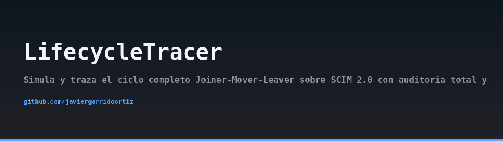
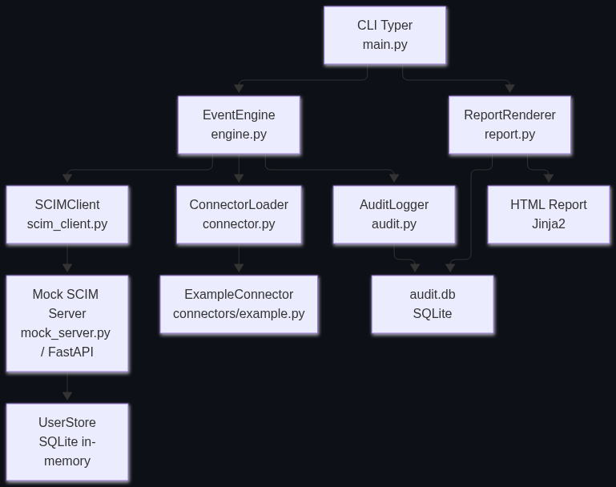
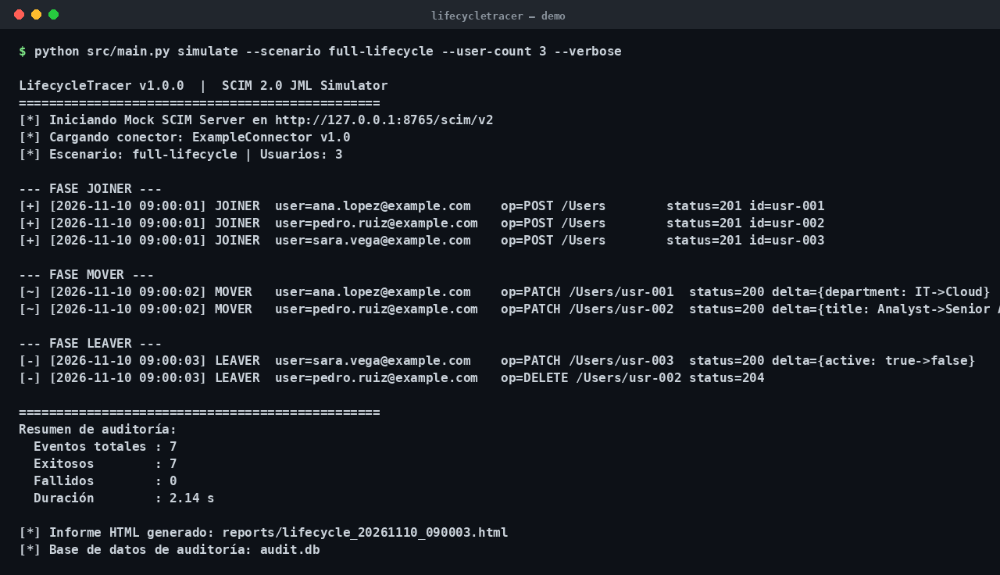

## Arquitectura



## Demo



> 🇬🇧 Read this in [English](README.en.md).

# LifecycleTracer

[](https://opensource.org/licenses/MIT)
[](https://www.python.org/downloads/release/python-3110/)
[](https://github.com/javiergarrido/lifecycletracer)

## Descripción del problema

Depurar flujos de identidad Joiner-Mover-Leaver (JML) en sistemas reales es una tarea compleja. Las organizaciones dependen de plataformas como SailPoint, Okta o Azure AD para gestionar el ciclo de vida de los empleados, pero cuando algo falla (un usuario no se crea, un cambio de rol no se propaga, una baja no desactiva la cuenta) los ingenieros se enfrentan a:

- **Falta de visibilidad**: los logs de los proveedores de identidad son opacos o están dispersos.
- **Dependencia de entornos reales**: probar cambios requiere acceso a un tenant real, con riesgos de seguridad y costes.
- **Complejidad del protocolo SCIM 2.0**: los payloads y las operaciones PATCH son propensos a errores.
- **Ausencia de trazabilidad**: no hay una auditoría clara de qué evento disparó qué llamada y con qué resultado.

LifecycleTracer nace para resolver estos problemas en un entorno controlado y reproducible.

## Qué hace LifecycleTracer

LifecycleTracer es una herramienta de simulación y trazabilidad que:

- Ejecuta escenarios JML definidos en YAML contra un servidor SCIM 2.0 simulado (o real).
- Registra cada evento del ciclo de vida en una base de datos SQLite con auditoría completa.
- Genera informes HTML detallados que muestran la secuencia de eventos, las peticiones SCIM y los resultados.
- Permite validar la corrección de los escenarios y de las implementaciones SCIM.
- Incluye un conector de ejemplo que transforma eventos JML en payloads SCIM, y una interfaz para crear conectores propios.

Es una herramienta educativa y de depuración, no un producto de gestión de identidades. No contiene código propietario de SailPoint ni de ningún otro proveedor.

## Arquitectura

LifecycleTracer se organiza en capas bien delimitadas:

- **CLI (main.py)**: interfaz de línea de comandos basada en Typer. Comandos: `simulate`, `report`, `validate`.
- **EventEngine (engine.py)**: orquesta la secuencia JML. Lee el escenario YAML, invoca al SCIMClient y registra eventos en el AuditLogger.
- **SCIMClient (scim_client.py)**: cliente HTTP basado en httpx que implementa las operaciones SCIM 2.0 (GET, POST, PATCH, DELETE).
- **Mock SCIM Server (mock_server.py)**: aplicación FastAPI que implementa los endpoints SCIM 2.0 y almacena usuarios en memoria. Se ejecuta en un hilo en segundo plano para coexistir con el CLI.
- **ConnectorLoader (connector.py)**: define el protocolo que deben cumplir los conectores. El conector de ejemplo (connectors/example.py) transforma eventos en payloads SCIM.
- **AuditLogger (audit.py)**: persiste cada evento en SQLite mediante sqlite3 estándar.
- **ReportRenderer (report.py)**: genera informes HTML usando Jinja2 a partir de la base de datos de auditoría.

Flujo típico:

```
Escenario YAML → EventEngine → SCIMClient → Mock SCIM Server
                      ↓
                AuditLogger (SQLite)
                      ↓
                ReportRenderer (HTML)
```

## Requisitos

- Python 3.11 o superior
- pip
- Entorno virtual recomendado (venv)

## Instalación

```bash
git clone https://github.com/javiergarrido/lifecycletracer.git
cd lifecycletracer
python -m venv .venv
source .venv/bin/activate  # En Windows: .venv\Scripts\activate
pip install -r requirements.txt
```

## Uso

### Comando `simulate`

Ejecuta un escenario JML contra el servidor SCIM simulado (por defecto) o contra una URL real.

```bash
# Simulación con el escenario de ciclo completo contra el mock local
python -m src.main simulate scenarios/full-lifecycle.yaml

# Especificar una URL SCIM real (por ejemplo, un tenant de pruebas)
python -m src.main simulate scenarios/joiner-only.yaml --scim-url https://mi-tenant.example.com/scim/v2
```

Durante la simulación se muestra el progreso con Rich y se almacena la auditoría en `audit.db`.

### Comando `report`

Genera un informe HTML a partir de la base de datos de auditoría.

```bash
python -m src.main report --output report.html
```

Abre `report.html` en un navegador para ver la secuencia de eventos, las peticiones SCIM y los resultados.

### Comando `validate`

Valida la sintaxis y estructura de un escenario YAML sin ejecutarlo.

```bash
python -m src.main validate scenarios/full-lifecycle.yaml
```

## Formato de escenarios YAML

Los escenarios definen una secuencia de eventos JML. Cada evento tiene un tipo (`joiner`, `mover`, `leaver`), un identificador de usuario y los datos asociados. Ejemplo completo de `scenarios/full-lifecycle.yaml`:

```yaml
name: Ciclo completo de empleado
description: Alta, cambio de departamento y baja de un empleado
version: 1.0
events:
  - type: joiner
    user:
      userName: jdoe
      name:
        givenName: John
        familyName: Doe
      emails:
        - value: jdoe@example.com
          primary: true
      department: Ingeniería
      active: true
  - type: mover
    userName: jdoe
    changes:
      department: Operaciones
      title: Ingeniero Senior
  - type: leaver
    userName: jdoe
    deactivate: true
```

Los campos admitidos son los definidos en el esquema SCIM 2.0 (RFC 7643). El conector de ejemplo mapea estos eventos a operaciones SCIM concretas.

## Cómo extender con un conector propio

Para crear un conector personalizado, implementa la clase `BaseConnector` definida en `src/connector.py`. Debes sobrescribir los métodos `to_scim_create`, `to_scim_patch` y `to_scim_delete`, que reciben un evento y devuelven el payload SCIM correspondiente.

Ejemplo mínimo:

```python
from src.connector import BaseConnector

class MiConector(BaseConnector):
    def to_scim_create(self, event):
        # Transformar evento joiner en payload SCIM
        return {
            "schemas": ["urn:ietf:params:scim:schemas:core:2.0:User"],
            "userName": event["user"]["userName"],
            # ...
        }

    def to_scim_patch(self, event):
        # Transformar evento mover en operaciones PATCH
        return {
            "schemas": ["urn:ietf:params:scim:api:messages:2.0:PatchOp"],
            "Operations": [
                {"op": "replace", "path": "department", "value": event["changes"]["department"]}
            ]
        }

    def to_scim_delete(self, event):
        # Transformar evento leaver en desactivación (PATCH) o borrado (DELETE)
        return {
            "schemas": ["urn:ietf:params:scim:api:messages:2.0:PatchOp"],
            "Operations": [{"op": "replace", "path": "active", "value": False}]
        }
```

Registra tu conector en la configuración o pásalo como argumento al comando `simulate` mediante `--connector mi_modulo:MiConector`.

## Referencia SCIM 2.0 (RFC 7644)

LifecycleTracer implementa un subconjunto de SCIM 2.0 centrado en la gestión de usuarios:

- **GET /scim/v2/Users**: lista usuarios (con filtros básicos).
- **POST /scim/v2/Users**: crea un usuario.
- **PATCH /scim/v2/Users/{id}**: modifica atributos (operaciones `add`, `replace`, `remove`).
- **DELETE /scim/v2/Users/{id}**: elimina un usuario.

Los payloads siguen los esquemas definidos en RFC 7643. Para más detalles, consulta la [RFC 7644](https://datatracker.ietf.org/doc/html/rfc7644).

## Nota sobre uso educativo y ausencia de código propietario

LifecycleTracer es un proyecto educativo y de código abierto. No está afiliado a SailPoint ni a ningún otro proveedor de gestión de identidades. Todo el código es original y no contiene fragmentos propietarios. El servidor SCIM simulado es una implementación simplificada con fines de prueba y aprendizaje; no debe usarse en producción.

## Licencia

Este proyecto se distribuye bajo la licencia MIT. Consulta el archivo [LICENSE](LICENSE) para más información.

---

Desarrollado por Javier Garrido Ortiz.